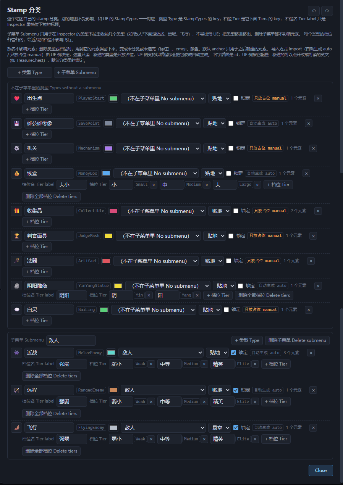

# MVMap

Forked from https://github.com/TitaniumCladStudios/MVMap

A metroidvania map editor. Paint rooms onto grid paper, colour them by area, connect them with doors, and model progression with locks and keys.

Version 2 is a small Vite + TypeScript app: rooms stay on the grid, while structures, edge structures, stamps, notes and keys can be placed off the grid at an adjustable snap step. No server, no account — it runs entirely in the browser.

Built to design an unannounced metroidvania.

---

## Running it

```sh
npm install
npm run dev        # editor at http://localhost:5173
npm test           # unit tests (node --test, Node 22.18 or newer)
npm run build      # type-check and build into dist/
npm run preview    # serve the built dist/
```

The build in `dist/` is static and uses relative paths, so it can be served from any folder of any static host. It does need to be served over HTTP — browsers don't run module scripts from `file://`.

`mvmap-types.js` and `mvmap-ue.js` stay plain scripts at the repo root (they are shared with the UE importer, its node tests and `export_mvmap_stamp_icons.py`); the page loads them before the app and the build copies them next to `index.html`. The editor warns and stops working without them.

### Deploying

`.github/workflows/pages.yml` builds the site on every push to `main` and deploys it with GitHub Pages (repository **Settings → Pages → Source: GitHub Actions**). The `v1` branch keeps the single-file 1.x editor.

---

## Why locks and keys

The core metroidvania principle is that the world is non-linear and gated. New areas are *locked*, and to get through a gate the player has to go find the thing that opens it — which usually isn't a key at all. It's a movement ability, an item, or a story beat.

So the interesting part of the design isn't the level geometry. It's the dependency graph underneath it, and graph paper can't show you that. MVMap models it directly:

- A **lock** is a concept, not a door. Put the same lock on every gap in the world that the grapple opens.
- A **key** is placed where the player finds it, and is rarely a literal key.
- The relationship is many-to-many. One lock can accept several keys — that's a sequence break you designed on purpose instead of one a speedrunner found for you. One key can open many locks.
- Selecting a lock or key draws dashed arrows from each key's location to every door it opens. Toggle **Show all lock ↔ key links** to see the whole progression graph laid over the geography.
- A lock with doors but no key that opens it is flagged as a soft-lock in the inspector.

---

## Features

**World grid** — unbounded grid paper, heavy line every 8 cells. Pan, zoom to cursor, zoom to fit. HUD shows the cell under the pointer, or the snapped position for the off-grid tools.

**Snapping** — rooms and doors always sit on whole cells. Everything drawn over them (structures, edge structures, stamps, notes and keys) snaps to the step picked under **Snap** in the left panel: `1`, `½` (default), `⅓`, `¼`, `⅙`, `⅛` of a cell, or **Free**. Hold `Alt` to toggle snapping for the moment — off when a step is picked, back to the last step when it's Free; the bar outlines the step in effect. The grid draws the step's sub-lines while an off-grid tool is active. The step is stored per browser in `mvmap:snap`.

**Rooms** — painted as arbitrary cell sets, so an L-shaped shaft, a ring, or a long corridor is *one* room rather than several boxes glued together. Only the silhouette is outlined, so it reads like an in-game map. Drag a room in select mode and everything sitting on it moves too: the doors it solely owns (doors shared with a neighbouring room stay anchored), the parts of structures and edge structures inside its cells (cut at the room's border), and the stamps, notes and keys centred in it.

**Areas** — colour-coded biomes. Rooms inherit the area colour, or override it individually. The room list groups by area. Adding an area opens a room inside it immediately.

**Doors** — placed on the edge *between* cells, not in them. Three kinds: passage, door, and one-way (with a flippable direction arrow). The inspector always names the two rooms a door actually connects.

**Locks and keys** — as above.

**Structures** — a second layer of named, coloured areas painted *on top of* rooms: walls, breakable or hidden walls, switches, mechanisms. A structure is a set of axis-aligned rectangles at the snap step — at `½`, a ledge one cell wide and half a cell tall is one stroke. Draw with **S-Paint** (a square brush the size of the step, `⅛` cell while snapping is free) or **S-Rect** (drag a box: from the step square under the press to the one under the pointer, or corner to corner when free); `Ctrl` erases with either. **S-Erase** removes structure area and cuts any edge structure it passes over, without touching the room beneath. Structures never overlap: painting one over another takes that area from the other. A structure can span several rooms.

**Negative structure (S-Neg, `G`)** — cuts a polygon out of the *active* structure, for slopes, ramps and other shapes rectangles can't make. Click the corners one by one (they snap like edge endpoints; `Shift` locks a side to 45° steps), then click the first corner again — or press `Enter` — to close the outline; the polygon's area is taken out of the structure. `Backspace`, `Ctrl`-click or right-click takes the last corner back, `Esc` drops the polygon, and a corner that would make the outline cross or touch itself is refused. Only the active structure is cut (pick it with Select or in its list first); other structures and rooms are untouched. Parts of the polygon that run along the grid simply leave the structure's rectangles; only a polygon with a slanted side is kept as a *cut*. Painting over a cut fills it again, and cuts move, copy and paste with their piece and travel with a moved room. Areas shown in the list and the inspector leave the cuts out.

**Edge structures** — named, coloured sets of line segments, drawn as thick bars: platforms, ledges, one-way floors. With the **Edge** tool, drag from one snap point to another to lay a segment at any angle; hold `Shift` while dragging to lock it to 45° steps (`Shift` held as you press starts a new edge structure). Click a segment to select it; `Ctrl`-drag erases. Segments on one line that touch or overlap merge, and an overlap with another edge structure goes to the one drawn last; crossings are allowed.

Both kinds get their own list in the left rail, an inspector with name, colour (palette or custom picker) and notes, and can be selected and dragged with the Select tool. Clicking on the map selects only the connected *piece* under the pointer — dragging moves it (snapped) and `Del` deletes it — so the separate parts of one structure stay independent (pick the structure in its list to select every piece): rectangles connect along a side (corner contact doesn't count), and segments connect when they share any point. Toggle them with **Show structures** / **Show structure names**.

**Stamps** — emoji markers the size of one cell, drawn on top of everything: save points, items, bosses, shops. Each stamp has a name, an emoji (pick from a 64-emoji palette or type one; the field accepts exactly one emoji), and a tile colour, and can be placed as often as you like, at any snapped position. Click with the **Stamp** tool to place, `Shift`-click for a new stamp, `Ctrl`-click to remove; clicking a placed stamp (Stamp or Select tool) selects just that copy — only it lights up — and dragging moves it; picking the stamp in its list selects every copy. Name, emoji, colour and type belong to the stamp and are shared by its copies. **Notes** belong to each copy: select a copy on the map to write its own in the Inspector (a copy with notes shows a small yellow dot in its top-right corner); they move, copy and paste with that copy and travel with a moved room. Two stamps can't sit at exactly the same spot — placing one there replaces the other.

**Stamp types in the inspector** — a stamp's inspector has one **类型 Type** dropdown: the types outside any submenu first, then one section per submenu (敌人: 近战 / 远程 / 飞行); each entry shows the emoji, the name and the import method. A type with tiers adds **档位 Tier · <tier label>** below it (档位 Tier · 强弱). The line under them gives the ids the UE importer uses and the import method once the stamp is complete (`UE: MeleeEnemy / Weak — 导入方式：自动生成 auto`, or `只放占位 manual`), and otherwise, in red, what is missing (`近战（未选强弱）`, `未分类`). Switching to a type whose tiers have the same tier label and include the picked tier (近战 → 飞行) keeps the tier; any other switch clears it (钱盒·中 → 近战: both have `Medium`, but 大小 is not 强弱). The UI uses one set of words, Chinese and English side by side:

| UI | File | UE |
|---|---|---|
| 子菜单 Submenu | `submenus[]`, a type's `submenu` | not read |
| 类型 Type | `types[]`, a stamp's `typeId` | a key of `StampTypes` |
| 档位名 Tier label | a type's `tierLabel` | — |
| 档位 Tier | a type's `tiers[]`, a stamp's `tier` | a key of that type's `Tiers`; the `MVMapTier:` tag |
| 导入方式 Import: 自动生成 auto / 只放占位 manual | `importMethod`, written on export only | whether `StampTypes` has the type |

**Stamp categories** — **Stamp 分类…** in the top bar opens the map's stamp submenus, types and tiers (the format is under File format). Every map has its own; editing one never touches another. In the panel:
- **+ 类型 Type** / **+ 子菜单 Submenu** add a type (outside any submenu) or a submenu; **+ 类型 Type** inside a submenu adds a type there. New ids are generated (`Type_k3x9qa`). A new type is 只放占位 manual: the UE importer leaves a placeholder for it until the UE side supports it and its id is added to `mvmap-types.js`.
- The types outside any submenu come first, then each submenu with its types, as in the inspector's Type dropdown. A type row edits the emoji, name, colour, submenu, default anchor and **锁定** (the type decides the anchor; the inspector hides the anchor dropdown). The import method is shown, not editable: it is decided on the UE side.
- A submenu only arranges the Type dropdown: it has a name and nothing else, and is never exported to UE. Moving a type into or out of a submenu, renaming a submenu or deleting one (its types stay, outside any submenu) changes no stamp. An empty submenu doesn't show in the inspector.
- Under each type, **+ 档位 Tier** gives it tiers: name them with **档位名 Tier label**, then add tiers with **+ 档位**. Every type has its own tiers, inside a submenu or not: adding Boss to 近战 doesn't touch 飞行. Stamps of a type with tiers are 未选完 until they pick one.
- Names commit on `Enter` or when the field loses focus. Renaming never changes a stamp: stamps store ids, not names.
- The id after each type and tier name is what the UE side configures by (typeId, tier id; icons are named `T_Emoji_MVMap_<typeId>`). Click it to give one you added a readable id (`TreasureChest`): letters, digits and `_`, starting with a letter, not used by another type (or another tier of the same type) nor still held by a stamp there. Its stamps follow. Ids of the default categories in `mvmap-types.js` are locked (solid border; a click says why): the UE side is configured for them.
- Deleting a type or a tier asks first and says how many stamps use it. Those stamps stay on the map: a deleted type leaves them 未分类, a deleted tier leaves `钱盒（未选大小）`; **删除全部档位 Delete tiers** takes the tier label too, and the type's stamps are complete again.
- Emoji, colour and default anchor only apply to stamps created afterwards: placed stamps keep theirs. A locked anchor applies to every stamp of the type.
- Every edit is one undo step (Ctrl+Z / Ctrl+Y, or the ↶ ↷ in the panel).



**Notes** — standalone annotations the size of one cell, drawn above everything else (stamps included). Unlike areas, rooms, structures and stamps there's nothing to pick from a list — every note is its own thing. Click with the **Note** tool (`N`) to add one (it snaps like stamps; drag a note to move it) and write its details in the Inspector. The **+** button on the note (or `Enter` while selected) expands it into a translucent text box beside the cell; the box's **−** button collapses it. Double-click the open box to type its details right on the map; clicking anywhere else (or `Esc`) finishes, and the whole edit is one undo step. A click on the map that ends an edit does nothing else, so it never paints or selects by accident. Drag the open box anywhere (in any tool, Pan included); it keeps that spot after collapsing and reopening, and **Reset box position** in the Inspector puts it back beside the note. The label under the note shows in both states and can be hidden with **Show name on map**. Delete with `Del`, `Ctrl`-click / right-click remove, or the Inspector; **Show notes** hides them all. Moving a room carries its notes along. (These are separate from the *notes* text field on rooms, structures and stamp copies.)

**Pencil** — freehand drawing on top of the map, off the grid, for sketches, arrows and quick annotations. Pick a colour (palette or custom) and a brush size in the bar that appears at the top of the map while the **Pencil** (`L`) or **P-Erase** (`Q`) tool is active. Pencil strokes don't belong to any area, room or structure, aren't picked by Select, and don't move with rooms. **P-Erase** — or `Ctrl` / right-click remove with the Pencil — rubs out pencil ink only, cutting strokes where the eraser passes; it never touches rooms, structures or anything else. **Clear all** in the bar removes every stroke (undoable). Strokes are saved with the map and included in export and PNG; **Show pencil drawings** in Options hides them.

**Hand-placed markers** — structures, edge structures and stamps the UE importer won't generate get a marker: types whose import method is 只放占位 manual an orange dashed outline and a **手** badge, 未分类 and 未选完 ones a red dotted outline and a **?** badge. Each connected piece gets its own badge (stamps: every copy); badges hide when cells are under 8 px on screen. **Highlight hand-placed only** in Options fades everything else except rooms. PNG export shows markers and fading as on screen.

**Options** — the view toggles (lock ↔ key links, room names, structures, structure names, notes, pencil drawings, highlight hand-placed only), **Stamp labels above zoom** and **Right-click** live at the bottom of the right panel. Stamp names only appear once the map is zoomed in past the stamp-label zoom (60 % by default), so a zoomed-out map stays readable.

**Right-click** — configurable under Options. *Remove* (default) acts like holding `Ctrl` with the current tool: erase room cells or structure area, cut edge segments, delete a door, key, note or stamp; with Select it removes the smallest thing under the pointer. *Hold & drag to pan* makes it a pan button instead. Stored per browser in `mvmap:rclick`.

**Copy & paste** — select a room, a structure or edge-structure piece, a stamp or a note, `Ctrl+C`, point at the map, `Ctrl+V`. The copy lands centred on the pointer, snapped to the current step (rooms to whole cells), and is selected; if the pointer is off the map or hasn't moved since the copy (or the last paste) it goes just to the right of the original (then of the last paste) instead, so a paste never lands on top of what it came from. A copied piece or stamp joins the set it came from, keeping its name and type (a new set with the same properties is made if that one is gone, e.g. after opening another map — the clipboard stays for the tab). A pasted note is a new note with the same label, text and colour. A pasted room is a new room named “… copy”, without a number, and brings the structure, edge-structure and stamp parts and the notes that would move with it; doors and keys stay behind. Like painting, a paste takes over the cells and structure area underneath. `Ctrl+Z` undoes it.

**Names & order** — a room's **Name position** puts its label in the centre or in one of four corners (anchored to a cell the room owns, so L-shapes keep it inside). Every inspector has a **Show name on map** toggle (on by default) and **Order** buttons that move the selection up or down its list; rooms reorder within their area. Lists draw in order, so later entries paint over earlier ones.

**Storage** — autosaves to IndexedDB (localStorage fallback) with a **Maps…** library for multiple projects. Export/import JSON, export the whole map as a PNG.

**Undo/redo** — snapshot-based, covers everything.

---

## Shortcuts

### Map

The tool keys below are the defaults. Rebind any left-panel tool under **? → Tool shortcuts**: click a key and press the new one; taking a key another tool already uses swaps the two. Modifier combinations and the reserved keys (`Space`, `F`, `Enter`, `Esc`, `Del`, `Backspace`, `[`, `]`, `Tab`) can't be bound, and holding `Space` always pans. **Export** / **Import** there save and load a `mvmap-shortcuts.json`; **Reset to defaults** restores the table below. Custom keys are stored per browser in `mvmap:keys`.

| Key | Action |
|---|---|
| `V` | Select / move |
| `B` | Paint cells |
| `R` | Rectangle fill |
| `E` | Erase cells |
| `D` | Door |
| `K` | Key |
| `S` | Structure paint |
| `T` | Structure rectangle |
| `X` | Structure erase |
| `G` | Negative structure (cut a polygon out of the active structure) |
| `P` | Edge structure (drag a segment) |
| `M` | Emoji stamp |
| `N` | Note |
| `L` | Pencil |
| `Q` | Pencil eraser |
| `[` / `]` | Move selection up / down its list |
| `Shift` + `[` / `]` | Move selection to top / bottom |
| `H` or hold `Space` | Pan |
| Hold `Alt` | Toggle snapping (structures, edges, stamps, notes, keys) |
| `Shift` + paint / click | Start a new room / structure / edge structure / stamp |
| `Shift` while dragging an edge | Lock the segment to 45° steps |
| `Ctrl` + paint / drag / click | Erase or remove instead (cells, structure area, edge segments, doors, keys, stamps, notes) |
| Right-click | Remove (like `Ctrl`), or hold and drag to pan (configurable) |
| `F` | Zoom to fit |
| `Enter` | Expand / collapse selected note |
| `Del` | Delete selection |
| `Ctrl+C` / `Ctrl+V` | Copy selection / paste at the pointer |
| `Ctrl+Z` / `Ctrl+Shift+Z` | Undo / redo |
| `Ctrl+S` | Export JSON |
| `Esc` | Deselect |

Mouse: scroll to zoom, middle-drag to pan.

---

## File format

`Export` produces a plain JSON document. It's stable, diffable, and safe to commit next to your game's source.

```jsonc
{
  "id": "map_a1b2c3",
  "version": 2,
  "name": "Ruined Keep",
  "updated": 1753660800000,

  "areas": [
    { "id": "area_x1", "name": "Sunken Cistern", "color": "#4c8dd8",
      "region": "XianZuCi", "letter": "B" }   // UE import fields, see below
  ],

  "rooms": [
    {
      "id": "room_y1",
      "name": "Flooded Shaft",
      "areaId": "area_x1",
      "color": null,              // null = inherit the area colour
      "notes": "Ambush after the water drains.",
      "cells": ["3,4", "4,4", "4,5"],
      "number": 1                 // UE import field, see below
    }
  ],

  "doors": [
    {
      "id": "door_z1",
      "x": 5, "y": 4,
      "o": "v",                   // "v" or "h" — see edge convention below
      "kind": "door",             // "passage" | "door" | "oneway"
      "dir": 1,                   // one-way only: 1 = +axis, -1 = -axis
      "lockId": "lock_q1"         // null when unlocked
    }
  ],

  "locks": [
    { "id": "lock_q1", "name": "Grapple Gate", "color": "#e0555f",
      "keyIds": ["key_k1", "key_k2"] }   // any one of these opens it
  ],

  "keys": [
    { "id": "key_k1", "name": "Grapple", "color": "#5aa9f0", "x": 9, "y": 2 }
  ],

  "structures": [
    { "id": "struct_s1", "name": "Breakable Wall", "color": "#c9885a",
      "notes": "Bomb it.", "typeId": "OneWayDoor",   // UE import field, see below
      "rects": [ { "x": 4, "y": 4, "w": 1, "h": 2 }, { "x": 5, "y": 5.5, "w": 1.5, "h": 0.5 } ],
      "cuts": [ [ { "x": 5.5, "y": 5.5 }, { "x": 6.5, "y": 5.5 }, { "x": 6.5, "y": 6 } ] ] }   // optional
  ],

  "stamps": [
    { "id": "stamp_m1", "name": "Save Point", "emoji": "💾", "color": "#5aa9f0",
      "notes": "", "typeId": "SavePoint", "anchor": "SnapToGround",   // UE import fields, see below; a stamp's own notes stay "" (notes are per point)
      "points": [ { "id": "pt_a1", "x": 6, "y": 4, "notes": "Before the boss" }, { "id": "pt_a2", "x": 9.25, "y": 2.5 } ] },
    { "id": "stamp_m2", "name": "钱盒", "emoji": "💰", "color": "#5aa9f0",
      "notes": "", "typeId": "MoneyBox", "tier": "Large", "anchor": "SnapToGround",
      "points": [ { "id": "pt_b1", "x": 12, "y": 4 } ] },
    { "id": "stamp_m3", "name": "敌人·近战", "emoji": "👾", "color": "#5fd8cf",   // 未选完: no typeId, see below
      "notes": "", "pendingTypeId": "MeleeEnemy", "anchor": "SnapToGround",
      "points": [ { "id": "pt_c1", "x": 14, "y": 4 } ] }
  ],

  "stampCategories": {            // this map's stamp types, see below; the defaults are in mvmap-types.js
    "submenus": [
      { "id": "Enemy", "label": "敌人" }
    ],
    "types": [
      { "id": "SavePoint", "label": "傩公傩母像", "color": "#7c879b", "emoji": "💾",
        "importMethod": "auto" },   // written on export only
      { "id": "MoneyBox", "label": "钱盒", "color": "#5aa9f0", "emoji": "💰", "importMethod": "auto",
        "tierLabel": "大小", "tiers": [ { "id": "Small", "label": "小" }, { "id": "Medium", "label": "中" }, { "id": "Large", "label": "大" } ] },
      { "id": "MeleeEnemy", "label": "近战", "submenu": "Enemy", "color": "#5fd8cf", "emoji": "👾", "importMethod": "auto",
        "anchor": "SnapToGround", "anchorLocked": true,
        "tierLabel": "强弱", "tiers": [ { "id": "Weak", "label": "弱小" }, { "id": "Medium", "label": "中等" }, { "id": "Elite", "label": "精英" } ] }
    ]
  },

  "pencil": [
    { "id": "pen_p1", "color": "#f0dc3a", "size": 3, "pts": [96, 128, 112.5, 131, 140, 150] }
  ],

  "notes": [
    { "id": "note_n1", "name": "Boss door", "text": "Opens after the Grapple fight.\nCheck the softlock.",
      "color": "#f0dc3a", "x": 5, "y": 3.5, "expanded": false }
  ],

  "edgeStructs": [
    { "id": "edge_e1", "name": "Ledge", "color": "#f0a13a", "notes": "",
      "segs": [ { "x1": 3, "y1": 5, "x2": 5, "y2": 5 }, { "x1": 5, "y1": 5, "x2": 6.5, "y2": 3.5 } ] }
  ]
}
```

### Conventions

**Version 2** (MVMap 2.0). Files from 1.x (`version: 1`, structures / stamps as `cells`, edge structures as `edges`) load fine and are converted on the way in: structure cells become rectangles, runs of edges on one grid line become segments, stamp cells become points. 2.0 always saves and exports version 2, which the 1.x editor can't read.

**Cells** are `"x,y"` strings in world grid coordinates, used by rooms (and doors' edges). Both axes are unbounded and may go negative.

**Off-grid coordinates** — structures, edge structures, stamps, notes and keys use numbers in cell units, with the same origin and axes as the cells (`x: 3.5` is half way across cell column 3). They lie on a lattice of 1/96 cell — 96 is a multiple of every snap step — and are written with at most 4 decimals (`⅓` is `0.3333`); readers that need exact values can round `v * 96` to an integer.

**Door edges** are identified by an orientation plus a cell coordinate:

- `"v"` at `(x, y)` is the vertical edge dividing cells `(x-1, y)` and `(x, y)`
- `"h"` at `(x, y)` is the horizontal edge dividing cells `(x, y-1)` and `(x, y)`

**Structure rects** are axis-aligned `{ x, y, w, h }` on an independent layer: an area can be in one room *and* one structure. The layer is exclusive — no point belongs to two structures, and a structure's own rects never overlap. They are kept in a canonical form: the area is cut into horizontal bands at every rect edge, each band's maximal runs are taken, and a run is stacked onto the rect above it when that rect has exactly the same x-range. The same area always gives the same list, and each connected piece's rects are exactly the canonical form of that piece.

**Structure cuts** (`cuts`, optional) are negative space: a list of simple polygons, each a list of `{ x, y }` vertices (closed implicitly, the first vertex isn't repeated), taken out of the structure's rects — the structure's solid area is its rects minus its cuts. A cut only affects its own structure. Every cut has at least one slanted side (the grid-aligned part of a polygon is taken out of the rects directly) and still covers some of the rects, but it may reach past them and may overlap or border the structure's other cuts. Vertices run clockwise on screen (positive signed area with y pointing down). Corners drawn by hand lie on the 1/96 lattice; a corner made where a cut was clipped against a rect side (by painting over it, or by moving, copying or carrying a piece) lies on that side, and its other coordinate can be any 4-decimal value. Structures without cuts have no `cuts` field. Connected pieces are still worked out from the rects alone.

**Stamp points**, **keys** and **notes** are `{ x, y }`, the top-left corner of the one-cell box they occupy; the centre is `(x + 0.5, y + 0.5)`. No two stamps share exactly the same point. Stamp points also carry an `id`, unique in the map and in the same format as element ids: a point gets a new one when it is placed, and keeps it while it is dragged or carried along by a moved room. Placing a point on another stamp's point deletes that point, id included; the new point has a new id. Points without an id (files saved before point ids) get one when the map is loaded. A point may carry `notes`, the designer's notes for that copy alone (absent when empty); the stamp's own `notes` stay `""`. A file from before per-copy notes has the stamp's notes copied to each of its points (that have none) when loaded, and the stamp's field emptied; a stamp with no points keeps them until its first point is placed, which takes them.

**Pencil strokes** are free polylines in world pixels (one grid cell = 32 px, same origin as the grid), stored flat as `[x0, y0, x1, y1, …]`; `size` is the stroke width in world pixels, so drawings scale with the map. A one-point stroke is a dot.

**Notes** sit at `(x, y)` as above, at most one at any exact spot. `expanded` is saved with the map, so an open note stays open. `box: { dx, dy }`, when present, is how far the open box was dragged from its default spot beside the note, in screen pixels (the box is drawn at a fixed screen size, so the offset holds at any zoom).

**`labelPos`** on a room places its name: `"tl"`, `"tr"`, `"bl"` or `"br"` for a corner; absent means centred.

**`hideName: true`** may appear on rooms, structures, edge structures, stamps, notes and keys to hide that object's label on the map. When absent the name is shown.

**Edge-structure segments** are `{ x1, y1, x2, y2 }`, any angle. Within one edge structure, segments on the same line that touch or overlap are merged, so the list never repeats a stretch; across edge structures a stretch belongs to at most one (crossings are fine). Segments are stored pointing left to right, or top to bottom when vertical.

**Grey-box data** (`detail`) from older files is dropped on load: 2.0 has no grey-box editor, since rooms are now laid out directly on the map.

**UE import fields** feed the NSProject whitebox importer, which builds sub-level names and FacilityID tags from them (`XianZuCi_Room_B01_LD`).
`area.region` is an `ENSRegionList` enum name picked from `mvmap-types.js`; it is set from any room's inspector and applies to the whole area.
`area.letter` is that region's letter, written on export only. `room.number` is a positive integer, unique within its area; the room's code is the letter plus the number padded to two digits (`B01`).
Export always writes all three, with `null` when unset; older files without them load fine. Duplicate numbers in an area, or unknown regions, are reported when a map is imported or opened from the library, and again on export.
`typeId` on structures and edge structures is a type id from `mvmap-types.js`, picked in the inspector's Type dropdown (only that layer's types are offered); the element's name is display only. An element with no `typeId` field gets one when a map is loaded, if its name is exactly a type's label for that layer; otherwise it is listed in red as 未分类. `typeId: null` (elements created in the editor, or 未分类 picked by hand) is never re-guessed from the name. A renamed type keeps its old ids and labels in `oldIds` / `oldLabels`: on load, a `typeId` that is an old id becomes the current id, and an untyped element named with an old label is classified too (e.g. `Wall` / 墙体 → `Landscape` / 地形). Picking a type for a new element that still has its default name (`Structure 1`, `Platform 1`, `Stamp 1`) also gives it the type's label, colour and (stamps) emoji. Export writes `typeId` only when it is a type of the element's layer, and leaves the field out otherwise.
**Stamp categories** (`stampCategories`) are stored in each map, so every map has its own: a map without them (new maps, files from before them) gets a copy of `defaultStampCategories` from `mvmap-types.js` when it is loaded, and a map that has them keeps them. They have the shape of the UE importer's settings, `types[id].tiers[tier]` ↔ `StampTypes[id].Tiers[tier]`:
- `types` is a flat list; a type's `id` is the stamp's `typeId` and unique across the categories. A type may have tiers: `tierLabel` (强弱, 大小: only the title of the inspector's tier dropdown) and `tiers`, a list of `{ id, label }` whose ids are unique within the type. Each type has its own: 近战, 远程 and 飞行 each list 弱小 / 中等 / 精英.
- `submenus` (`{ id, label }`) only arrange the inspector's Type dropdown; a type points at one with `submenu`. The UE importer doesn't read them.
- A stamp stores its type's id in `typeId` and one of the type's tier ids in `tier`. It is **complete** once it has its type and, if the type has tiers, one of them; with a type that has tiers but none picked it is **未选完** and listed in red with what is missing (`近战（未选强弱）`); without a type it is 未分类. An id that isn't in the map's categories (a hand-edited file) counts as not picked.
- Picking a type for a new stamp names it `submenu·type` (`敌人·近战`); picking a tier adds it to a name the editor gave (`钱盒` → `钱盒·中`, `敌人·近战` → `敌人·近战·精英`) and replaces the previous tier there, and switching the type renames a stamp still named by the editor (`敌人·近战·精英` → `敌人·飞行·精英`); a name typed by hand is kept.
- **Import method** (`importMethod`: `auto` / `manual`) is not stored in the map: it is a fact of the UE side, mirrored in `defaultStampCategories` in `mvmap-types.js`. A type listed there takes the value there, any other type is `manual`, whatever the file says. Export writes it on every type of `stampCategories.types` for the UE importer's summary; loading drops it. Structure and edge types carry their own `importMethod` in `mvmap-types.js` `types`.
- Export writes `typeId` on complete stamps only, and `tier` whenever it is one of its type's tiers. An incomplete stamp keeps its type as `pendingTypeId`, which the UE importer doesn't read and which loading the file turns back into `typeId`.
- Importing a file whose categories were edited by hand repairs them (entries without an id or with a repeated id are dropped, as are broken tiers and a tier label without tiers; tiers without a tier label are called 档位; missing names and fields get defaults) and lists every change in a message.
- Maps saved before the categories matched UE (`groups` with a `tier` each, a type's `tier: { label, values }`, `group`, `generate`) are upgraded on load, without a message: each group becomes a submenu and its tier is copied to every type in it, a type's own tier becomes `tierLabel` + `tiers` (unless its group had a tier: that one wins, as it did before), `group` becomes `submenu`, and `generate` is dropped. A stamp that had only a group picked (`typeGroup`) opens 未分类, its name kept.
- Stamps saved before the categories carry old typeIds; `oldStampIds` in `mvmap-types.js` maps each to a type and tier (`MediumMeleeEnemy` → 近战 + 中等); when the map's type no longer has that tier, the stamp gets the type with no tier picked, and when the map no longer has the type, the stamp keeps its old typeId (未分类). `EliteEnemy` (精英怪) has no type: those stamps open 未分类, their name kept, for the designer to pick 近战 or 飞行. `MoneyBox` and `YinYangStatue` kept their typeId, so those stamps open with only the tier left to pick.

Designers edit the categories in the **Stamp 分类…** panel (see Features). When the UE side starts generating a stamp type (adds it to `StampTypes`), the same change adds it to `defaultStampCategories` with its id and `importMethod: "auto"`, in a pull request to this repo: every map then shows it as auto and its id is locked, without editing any map.
`anchor` on stamps says how UE places the object: `SnapToGround` (on the ground found below the marker box) or `FloatInAir` (at the bottom of the box). It is picked in the inspector's Anchor dropdown; a new stamp, or one loaded without an `anchor`, gets its type's default (the type's `anchor` in the stamp categories, else `SnapToGround`). Types with `anchorLocked` (the enemies: ground or flying) fix it: the dropdown is hidden and export always writes the type's anchor. Export writes `anchor` on every stamp.

**Import** always assigns a fresh `id`, so importing a file can never overwrite a map already in your library. The map that was open becomes the newest undo step, so `Ctrl+Z` straight after an import brings it back.

### Browser storage

| | |
|---|---|
| IndexedDB | database `mvmap2`, object store `maps`, keyed on `id` |
| localStorage fallback | `mvmap2:docs` — all documents, keyed by id |
| localStorage | `mvmap2:last` — id of the last-opened map, restored on load |
| localStorage | `mvmap2:v1-imported` — set once the 1.x library has been copied over |

2.0 keeps its library apart from 1.x (database `mvmap`, `mvmap:docs`, `mvmap:last`), so that a 1.x editor on the same site can never load a version-2 map and save it back without its geometry. The first time 2.0 starts in a browser it copies every 1.x map into its own library, converted to version 2; the 1.x library is left untouched. The per-browser preferences below are shared by both.
| localStorage | `mvmap:rclick` — right-click behaviour, `remove` or `pan` |
| localStorage | `mvmap:pencil` — pencil colour, brush size and eraser size |
| localStorage | `mvmap:stampzoom` — zoom percentage above which stamp names show (default `60`) |
| localStorage | `mvmap:keys` — custom tool shortcuts, `{ "toolId": "key", … }` |
| localStorage | `mvmap:snap` — snap step: `1`, `1/2`, `1/3`, `1/4`, `1/6`, `1/8` or `free` |

---

## Repo

```
index.html          page shell; loads the two scripts below, then src/main.ts
mvmap-types.js      vocabulary shared with the UE importer (regions, structure / edge types, default stamp categories,
                    old stamp ids); edit this, not the app
mvmap-ue.js         pure helpers for the UE import fields (validation, room code, element types, stamp category edits,
                    export shape)
src/
  model/            document types, newDoc, migrate (incl. 1.x -> 2.0), colours and emoji
  geom/             tick lattice and snap steps, rect regions (union / subtract / canonical form / pieces / outline),
                    segments (merge / cut / pieces), polygons for structure cuts (clipping against rects, area)
  state/            runtime state, undo, storage, snapping, room / door / key edits, off-grid layer edits, pencil
  render/           camera, grid / rooms / doors / keys, structures / edges / stamps / markers, notes, render loop
  tools/            pointer and keyboard input, tool shortcuts
  ui/               panels, inspector, stamp category panel, snap bar, pencil bar, modals
  io/               JSON import / export, PNG export
  styles/           app.css
test/               node --test: vocabulary, UE helpers, geometry, 1.x migration, stamp point ids, stamp categories and
                    their edits
docs/2.0-design.md  2.0 design decisions
export_mvmap_stamp_icons.py   renders the emoji of every stamp type and of manual structure / edge types as UE placeholder icons (reads the stamp font from src/);
                              `--map <file>.mvmap.json` takes the stamp types from that map's categories, types designers added included,
                              without it (or for a file without categories) the defaults in mvmap-types.js
```

---

## Notes

Tested in Chromium-based browsers. Requires Canvas 2D, IndexedDB or localStorage, and pointer events — nothing exotic, but there's no polyfill layer, so a very old browser will simply fail rather than degrade.

1.x was a single `index.html`; it lives on in the `v1` branch.
